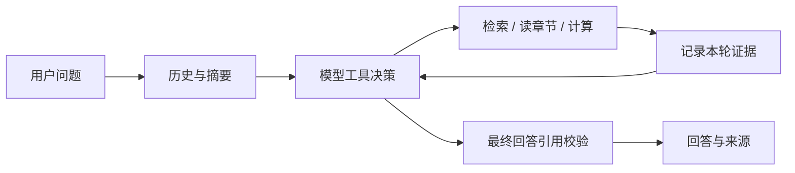

# 跟踪一次 DocAgent 请求

## 1 先实际运行
启动 README 中的命令。先问“FastAPI 默认端口是多少”，再问“那交互文档的地址是什么”。先观察工具轨迹，再展开证据。无密钥时出现服务不可用是预期配置错误，不是模型回答。

## 2 按调用顺序阅读
`docagent/api.py` 校验 message 和 session_id，同步接口调用 Engine.run，流式接口迭代 Engine.events。Engine 的事件生成器运行在 FastAPI 工作线程，避免同步模型调用阻塞主事件循环。

`docagent/engine.py` 先取会话上下文，注册工具，然后调用 bind_tools。模型返回 tool_calls 时，程序验证并执行工具，把结果包装为 ToolMessage 再交回模型；没有工具调用时尝试得到最终回答。模型决定下一步，Python 控制权限、次数和异常。这是 Agent 与固定“检索→生成”RAG 的核心区别。

`docagent/retrieval.py` 负责切块、BM25、向量召回、RRF和重排。BM25 关注词项，向量关注语义；RRF 合并排名，不直接混加不同量纲的原始分数。精排比较问题与候选原文，不创造新证据。

`docagent/safety.py` 用 AST 检查算术表达式，未使用 eval。请运行 malicious_calc 测试，观察恶意函数调用被拒绝。

`docagent/memory.py` 用参数化 SQL 保存会话，摘要减少下一轮输入量，原始消息不会删除。摘要可能遗漏信息，因此不能把它当作知识库来源。

## 3 亲手做四个实验

1. 比较固定切块和结构化切块：观察同一问题的前五条命中，解释为什么“切得更细”不一定更好。
2. 关闭混检和重排，复跑同一评测集：记录配置与题目 id，而非只比较两张总分截图。
3. 修改工具参数 top_k 为99，观察工具报错如何反馈给模型；然后检查六步上限测试。
4. 让最终答案引用不存在的编号，确认系统拒答；再构造“编号合法、内容错误”的答案，理解引用格式校验的能力边界。

## 4 怎样解释项目

能指着一条实际 trace 说明：为什么先 search_docs，再 read_section；哪些文本进入上下文；calculate 用了哪些有出处的数值；回答引用从哪里来；错误怎样重试与停止。

目前可以写的事实是实现的工具、接口、记忆与测试。召回提升、正确率、P95 延迟和平均步骤必须引用本项目评测输出，并交代模型、文档版本、样本、冷/热启动及审核方法。不要沿用简历原先的数字。

建议面试回答顺序：用户问题→证据→工具执行→结果→失败案例→改进依据。不要把库名罗列当作实现说明。

## 两个项目的区别

| 问题 | 健康档案 RAG | DocAgent |
|---|---|---|
| 谁决定下一步 | Python 固定流程 | 模型选工具，Python 约束执行 |
| 能否多次查资料 | 单轮检索后生成 | 可以检索、读章节、再检索或计算 |
| 状态保存在哪里 | 请求中的消息与索引 | SQLite 原始会话、摘要、本轮证据集合 |
| 如何控制错误 | 患者过滤、引用格式守卫、降级 | 再加 JSON Schema 参数校验、工具错误反馈、六轮停止 |

## 面试中容易混淆的细节

- 六步上限是六次模型决策，不是六个工具；单步至多执行三个工具。把两者混称会导致成本解释错误。
- Function Calling 不会自动执行 Python：模型返回名字和参数，程序查白名单、校验并执行，再把 ToolMessage 返回模型。
- FAISS 保存的是稠密向量索引，文本和章节需要自己关联。BGE-M3 负责文字编码，不直接理解图片。
- BM25 分数、向量内积分数和 CrossEncoder 分数不是同一量纲；RRF 依据排名融合，重排处理候选集合。
- 带编号的错误答案仍可能通过格式守卫。真正的引用支持率来自逐条证据核验，这也是人工评分工具的用途。
- 当前上下文预算用字符数近似，不能声称精确控制 token；摘要有损但原始历史仍可追溯。
- SSE 是传输方式，不会让计算更快。当前工具状态即时返回，正文校验完成后才分段发送。
- 评测延迟必须说明是否包含冷加载、检索和网络。离线 BM25 毫秒耗时不能写成整个 Agent 的端到端延迟。

## 建议的第一次动手任务

先不要修改 Prompt。运行测试，再选择一条真实检索结果，逐个查出：问题文字、实际策略、召回片段、章节和引用 id。随后在 tests/test_runtime.py 中阅读 test_multistep_evidence：它用脚本模型控制两次工具调用，证明运行时能够正确衔接，不能证明真实模型一定会做出相同决策。

完成密钥配置后，换成真实 DeepSeek 运行同一个问题。比较真实 trace 与脚本测试：记录模型选了哪些工具、是否遗漏证据、在哪个步骤停止。能够解释差异，比背诵 ReAct 定义更有帮助。
